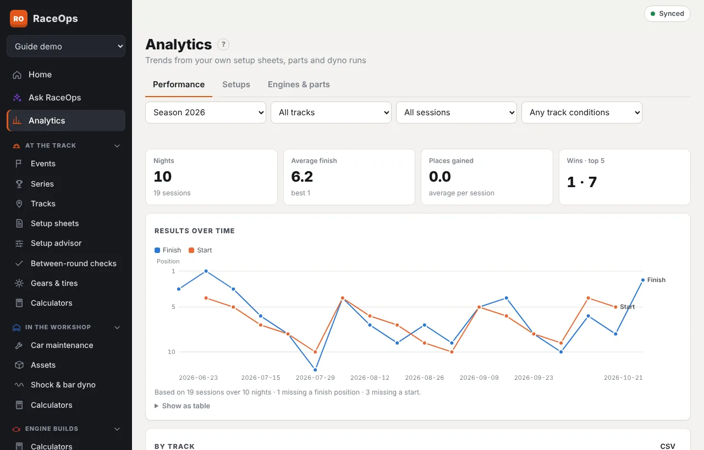
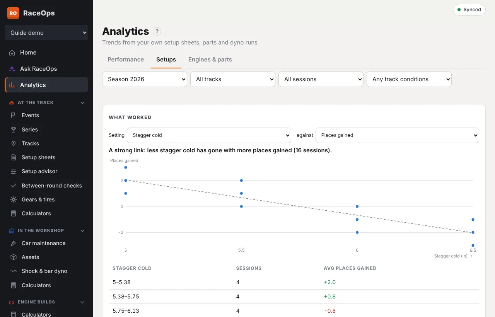

**Analytics** (in the sidebar) turns what you record on setup sheets, parts and dyno runs into charts. You don't fill anything extra in. It works offline, because it's worked out on your device from your synced data.

## Filters

The row under the tabs narrows everything on the page:

- **car** (if you run more than one);
- **period:** a season, the last 12 months, or all time;
- **track**;
- **sessions:** features, heats and qualifying, or all;
- **track conditions**, e.g. only *Slick* nights. Add more than one to include any of them.

Every chart says what it's **based on**, e.g. *Based on 34 sessions over 17 nights · 6 missing a finish position*. Missing results are left out, so fill in start and finish on every sheet. **Show as table** under a chart lists every value. **Tap a point** to open the setup sheet or record behind it.

## Performance

- **Headline numbers:** nights raced, average finish, average places gained (start − finish) and wins / top 5.
- **Results over time:** start and finish for every session. Position 1 is at the top.
- **By track:** nights, average finish, places gained, best result and wins at each track, best first. **CSV** downloads it.
- **Track conditions** and **the air:** average finish and places gained by condition (slick, heavy, tacky…), by ADR band and by temperature.
- **Handling comments:** how often each driver or crew-lead comment comes up, where it comes up most, and **went away after**. That's what you changed between a session with the comment and the next session that night without it. It shows what you tried, not proof it fixed it.

## Setups

- **What worked:** pick a setting (stagger, wing, a corner's pressure, ride height, main jet…) and a result (places gained or finish).
  - The chart plots every session with a trend line, and a sentence says how strong the link is, e.g. *A moderate link: less stagger cold has gone with more places gained (23 sessions)*.
  - The table below averages the result for each band of the setting.
  - Use the track conditions filter to compare like with like.
- **Setup drift:** follow up to four settings session by session, one small chart each, so slow creep stands out.
- **Jetting vs air:** the main jet you ran at each ADR, with the trend through it. The table is your own jet chart: the jet you ran most in each ADR band, the range, and what your line suggests.

## Engines & parts

- **Service forecast:** every part with a life limit in laps or races, and every lap- or race-based service schedule.
  - It works out average use per meeting over the last six meetings, how many meetings are left, and an approximate due date from your usual gap between meetings.
  - Soonest first; **CSV** downloads it.
- **Engine health:** pick an engine to see fuel per lap, highest and lowest rpm by meeting, and dyno HP from its build sheets. Rising fuel use or falling rpm can point to wear.
- **Shock fade:** pick a shock to compare its dyno runs. Force at about 5 in/s on each run against its [initial measurement](/help/dyno) (or the first run if none is marked), with the change as a percentage. Runs with adjuster settings (sweeps) aren't compared yet.

## On Home

**Form & what's due** shows your last five features' average finish and places gained, and how many parts are due within two meetings.

## Who can see it

Analytics is a licence feature and a role right (**Analytics → view**, in [Roles and permissions](/help/roles-permissions)). The built-in Crew Chief, Mechanic and Driver / Viewer roles have it.
