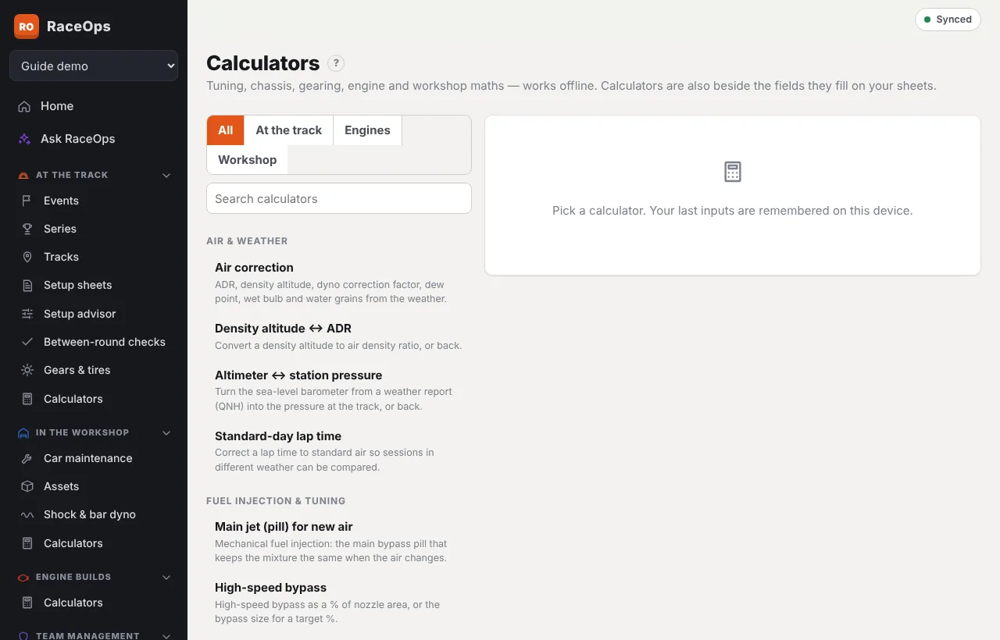

**Calculators** is under At the Track, In the Workshop and Engine Builds. Each opens the same page, filtered for that area. Search by name, or filter by group. Every calculator:

- works offline;
- shows how its answer is worked out;
- remembers your last inputs on this device.

## On the sheets

A small calculator button beside a field opens the matching calculator, filled in from the sheet. Press **Use** to put the answer back in the field. For example:

- main jet (it also uses the previous session's ADR and pill);
- high-speed bypass, stagger, ADR and ALT;
- tach, and fuel started;
- cam centreline, chamber, ring gap and dyno HP on build sheets.

On setup sheets, entering four **corner weights** fills in the percentages.

## Every calculator

{{calculators}}
