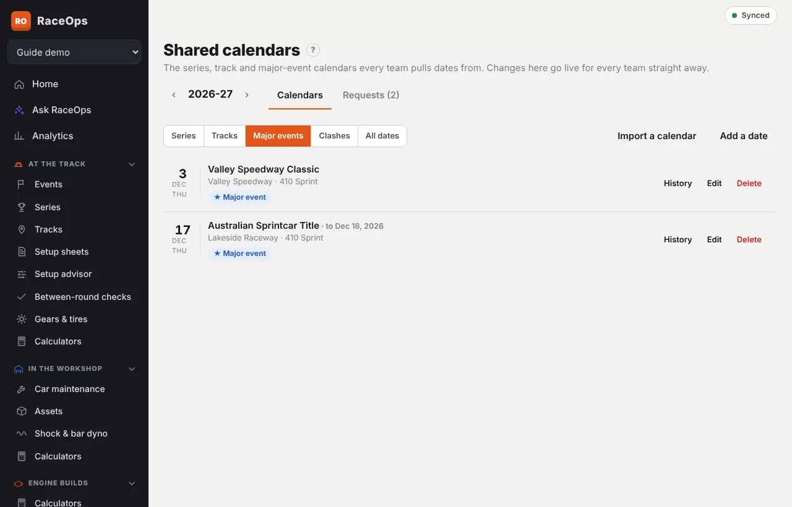
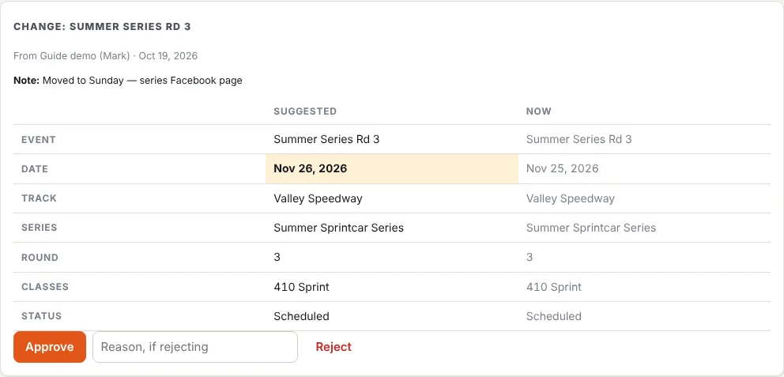

The shared calendars hold every series, track and major-event date that teams pull into their own calendars. As a platform admin you keep them right. Open **Platform admin → Shared calendars**.

Use **‹** and **›** to change the year. Anything you save here goes live for every team straight away.

## Calendars

Choose a view:

- **Series**: every shared series for the year, including new ones with no dates yet. Tap one to see and manage its rounds. **Edit series** changes its name, season, class, sanctioning body or other details.
- **Tracks**: every track with dates this year. Tap one for its dates.
- **Major events**: titles, championships and classics, such as the Australian Sprintcar Title.
- **All dates**: everything for the year.

### Add or change dates

- **Add a date**: fill in the event name, date, track, series and round, and the classes running. For a meeting over more than one day, tick **Runs over more than one day** and set each day's date (and its name and start time, if known). The days can have gaps. Teams' entries take the same days. Tick **Major event** for a title or classic and give it its **Major event name**, and set the **Sanctioning body** if it differs from the series'. Adding from a series, track or the Major events view fills that in for you.
- **Edit**: change a date. The form opens under that date, with **Save** and **Cancel** at the top, so you don't have to scroll past the whole form. Every team's entry that came from it changes too.
- **Delete**: removes the date from the shared calendar. Teams that already added it keep their own entry. To keep it visible but show it's off, edit it and set **Status** to **Cancelled** instead.
- **New series** (in the Series view): adds a series every team can use. Name and season are required.
- **Dates in a series** (open a series and press **Edit series**): **Dates in this series** lists its dates with their rounds; **Take out** removes one from this series only. Under **Add shared dates**, search the shared dates, tick each one that belongs, set its **Prefix** (**Round**, **Night**, **Prelude**, or blank) and **Round**, and press **Add N dates to …**. A date already in another series keeps it and counts towards both. Teams' entries from those dates follow.
- **Import a calendar**: read the dates from a link, iCal feed, PDF, photo, screenshot or pasted text, check them, then save. The AI reading counts against the team you're signed in to, so that team needs the AI add-on (iCal doesn't).

### Tools for a series or track

Open a series or track and these buttons show beside its name:

- **Officials**: teams that look after it, such as the series organiser or the track. Pick a team and press **Add official**. Tick **Auto-approve** to let its changes, new dates and results go live without you, unless they look like a duplicate or clash. Those still come to you. **Remove** takes it away. The team is told when it's made an official.
- **Feed**: the series' or track's own iCal link (`https://…` or `webcal://…`). Press **Add feed**. It's checked every 12 hours, and **Check now** checks it straight away. New dates arrive as one request (**Feed: … — N new dates**). Changed dates arrive as change requests. Both are marked **Feed** in **Requests**. The last check's result shows under the link.
- **History**: every saved version of the series or track, newest first, with who changed it and what changed. **Restore this version** puts an older one back. Each date has its own **History** too. Teams' entries follow a restored date.
- **Merge…**: move everything from this series or track into another one, then retire this one. See [Merge duplicates](#merge-duplicates).

**Public page** and **Subscribe** show the same public page and iCal link teams see.

### Merge duplicates

**Find duplicates** (in the **Series** and **Tracks** views) lists pairs with the same or similar names. Press **Keep the first** or **Keep the second**. Or use **Merge…** on a series or track and pick the one to keep.

Merging:

- moves every shared date onto the one you keep;
- repoints every team's events, series entries, track links, notes and follows, and removes any doubled-up copies;
- moves officials, feeds and requests across;
- retires the other one. It stays in **History**.

## Requests

Teams send their own series, tracks, dates and major events, and ask for changes to shared ones. The **Requests** tab shows how many are waiting. So does the number beside **Shared calendars** in the sidebar, and a note on Home.

Each request shows the team and person who sent it, when, and any note. Before you decide, every request is checked against the shared calendars:

- **⚠ Same as / Looks like**: a series or track with the same or a similar name (and season, for series) is already shared.
- **⚠ Already listed**: a date at the same track on the same day (or the same series round on the same day) is already shared.
- **⛔ Clash**: the same series round is already listed on another date, or the same track has a different meeting that day.

### Deciding

- **The series or track**: choose **Add as a new shared series/track**, or **Use the shared … instead** to merge it into one that's already there. An exact match is picked for you.
- **Each date**: choose **Add**, **Link to** an existing date it duplicates (picked for you), or **Refuse** with a reason the team will see.
- **A change**: the requested values are shown beside the current ones, with the differences highlighted.

Press **Approve** (or **Approve the rest** when you've refused some dates). To turn the whole request down, type a **Note to the team** and press **Reject all**.

Not sure? Type a question and press **Ask the team**. The request moves to **Asked the team**, and the team sees **Question for you**. When they press **Send answer**, it comes back to **Waiting** with their answer in the thread. You can still decide while you wait.

Requests marked **Feed** came from an official feed, and **Official — automatic** ones were approved for an official team. They're listed so you can see what changed.

### What approving does

- **Shared records become the single source of truth.** The series, track and dates are added (or matched to existing ones).
- **The team is relinked.** Its own copies of the series and track are retired. Its events, series entries, track links and contacts point at the shared records. Private notes from its copies become the team's own notes on the shared record.
- **Loose dates are tidied.** Shared dates that only had the track's name are linked to the newly shared track.
- **Teams follow changes.** When a shared date changes, through a change request or your own edit, every team's entry from that date follows it. Their car, plan, result and notes are kept.
- **The team is told.** It sees the outcome under **Calendar → Requests**, with every refused date and its reason.

The filters are **Waiting**, **Asked the team** and **All**. **All** shows past requests and who decided them.

## Results

When a shared date has run, its results (finishing order, entries and a note) can be entered by you with **Edit**, or reported by a team with **Report results**. Reported results come in as change requests. Approved results show on the date for every team, on public pages, and as an update for teams following the series or track.

## Email notifications

To send emails, set `SMTP_HOST` (plus `SMTP_PORT`, `SMTP_USER`, `SMTP_PASS` and `SMTP_FROM`) and `APP_URL` in the server's settings (the Portainer stack). **Platform admin → Settings → Email notifications** shows whether email is on. Press **Send me a test email** to check it.

With email on, platform admins get an email for each new request and each answer. Teams get an email when a request is decided, when you ask a question, when they're made an official, and when something they follow changes. Anyone can turn these off under **Profile & device**.

## From a team's calendar

You can also manage shared dates from **Team Management → Calendar → Shared calendars** in any team you belong to. There, **Add a date**, **Edit** and **Import a calendar** publish straight away. Untick **Publish to every team now** to save one as a suggestion instead.
