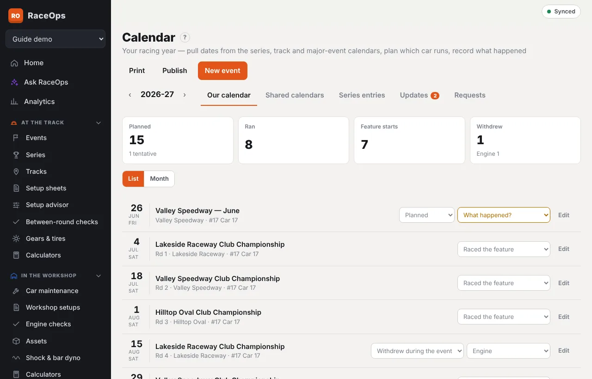
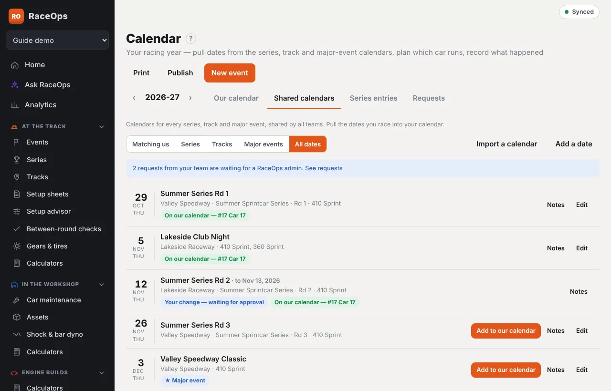
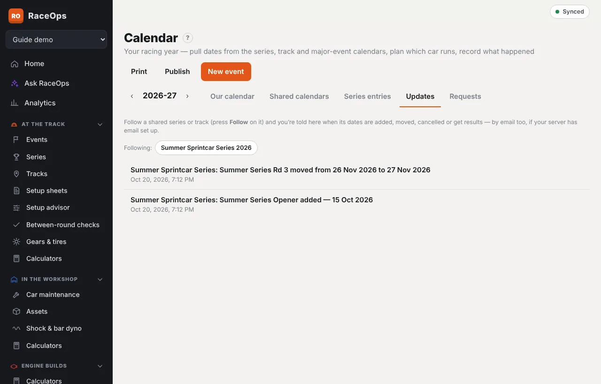
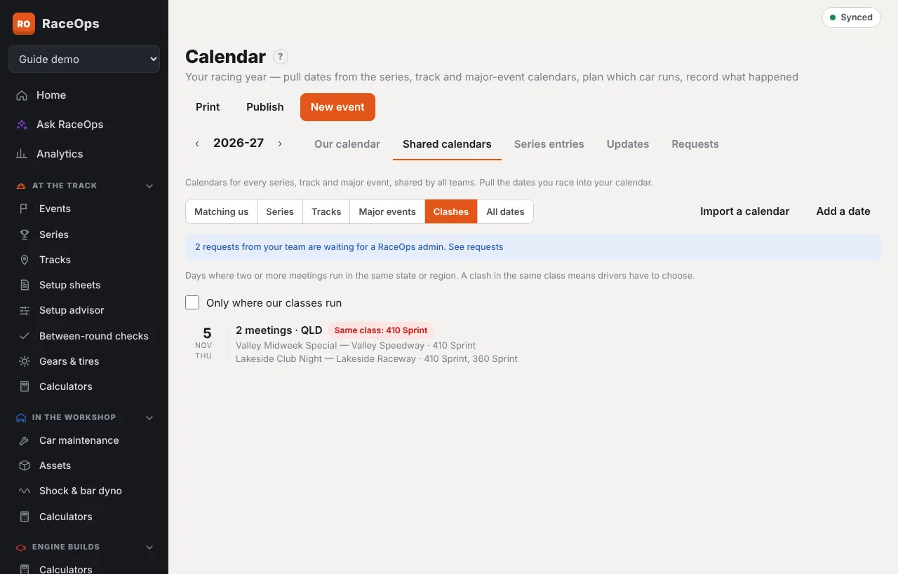
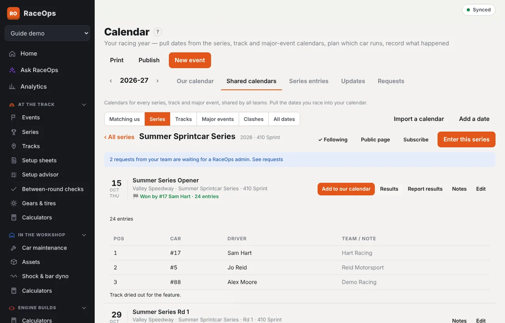
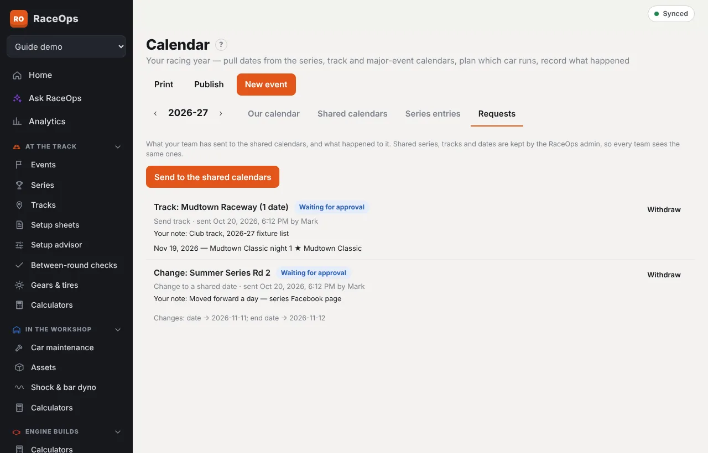
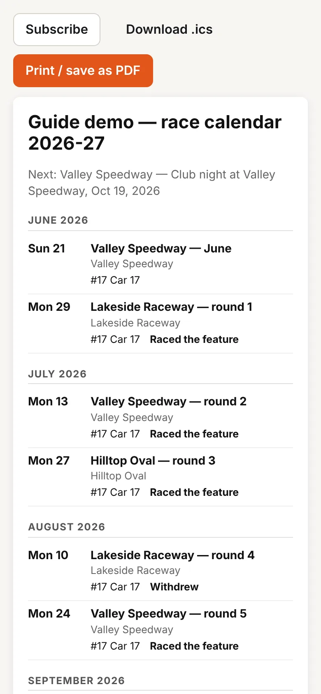

The **Calendar** is your team's racing year in one place: every meeting you plan to race, which car is going, and what happened. It's under **Team Management → Calendar**. Anyone whose role can see the calendar finds it there, including drivers and crew who don't otherwise use Team Management.

Each entry on your calendar is an **event**, the same event you add setup sheets to on the night. You can add dates from the shared calendars or create your own events.

## The racing year

The calendar shows one racing year at a time. Use **‹** and **›** beside the year to move between years.

Your team's year starts in January unless you change it. For a summer season (for example October to April), set **Racing year starts in** to July under **Publish**. The year then shows as *2026-27*. Only people who can edit team settings can change this.

## Shared calendars: series, tracks and major events

Every series and every track has one shared calendar, used by all teams on RaceOps. **Major events** collects the big one-off meetings, such as the Australian Sprintcar Title or a classic. Open **Shared calendars** to see the dates for the year.

Choose a view at the top:

| View | What it shows |
|---|---|
| **Matching us** | Dates where one of your cars' classes is running, plus the series you've entered. This is the default. |
| **Series** | Each series with dates this year, how many, and the next one. Tap a series for its rounds. **Entered** marks the series you're in. |
| **Tracks** | Each track with dates this year. Tap a track for its race nights. |
| **Major events** | Titles, championships and classics, wherever they're held. |
| **All dates** | Everything for the year. |
| **Clashes** | Days with more than one meeting in the same region. See [Clashes](#clashes). |

Major events are marked **★ Major event** wherever they appear, including on your own calendar. The track and series pages link to their calendars too.

### Add a date to your calendar

1. Press **Add to our calendar** on the date.
2. If only one of your cars races a class that's running, it's picked for you.
3. If more than one of your cars could race (for example a 410 and a 360 night), tick the cars that are going. Each car gets its own entry.
4. Choose **Planned** or **Tentative**, then press **Add**.

Dates on your calendar show **On our calendar — #12**. Use **Add another car** to add a second car later.

### When a shared date changes

When a shared date changes (a round moves, the track or name changes), your entry changes with it automatically. Your car, plan, result and notes stay as they are. A cancelled date shows **Cancelled**.

If you edited your own entry's date while offline, the entry shows **The shared calendar changed** with the old and new details. Press **Update ours** to bring it back into line.

### Follow a series or track

Press **Follow** on a shared series or track (in **Shared calendars**, or on its page under **Series** or **Tracks**). It changes to **✓ Following**. Press it again to stop.

**Calendar → Updates** then lists every change to what you follow, newest first:

- a date **added**;
- a date **moved**, with the old and new date;
- a date **cancelled** or removed;
- **Results are in** for a date.

New updates are marked **New**, and **Calendar** in the sidebar shows how many until someone opens **Updates**. If your server has email set up, the people who look after your calendar get an email too (see [Emails](#emails)).

### Clashes

The **Clashes** view lists days where two or more meetings are on in the same region, so you can see where a choice has to be made. **Same class** marks days where more than one meeting runs a class you race. Tick **Only where our classes run** to hide the rest.

### Results

After a shared date has run, it can show the results for every team:

- **🏁 Won by #17 …** shows on the date, and on your own entry for it.
- **Results** opens the finishing order (position, number, driver and team), the number of entries and any note.

To add them, press **Report results** on the date, fill in the finishers you know, and press send. Results go to the platform admin for approval like any other change. If your team looks after that series or track (see [Officials](#officials)), the button is **Add results** and they may go live straight away.

### Public page and subscribe

Every shared series and track has a public page anyone can open, without signing in. In **Shared calendars**, open a series or track and press **Public page**, or use **Public page & subscribe** on its page under **Series** or **Tracks**.

- **Public page** lists the year's dates, with winners for the ones that have run.
- **Subscribe** gives an iCal link. Add it to Google, Apple or Outlook calendar and it keeps itself up to date.

## Enter a series

Entering a series records which car you're running in it and whether you're doing the whole series.

1. In **Shared calendars → Series**, tap the series and press **Enter this series**. Or open **Series entries** and press **New series entry**.
2. Pick the **Car**. The **Class** fills in from the car.
3. Choose **Full series** or **Partial series**.
   - **Full series** adds every round to your calendar for that car.
   - **Partial series** lists the rounds. Tick the ones you'll run.
4. Press **Save entry**.

**Series entries** shows each entry with how many rounds are on your calendar. If the series adds a round later, press **Add missing rounds**. Deleting an entry leaves its events on your calendar.

## Quick edit an entry

Press **Edit** on any entry in **Our calendar**. The quick edit opens right under that entry, so you don't lose your place. You can change:

- the **event name**, **date** and **end date**;
- the **Series** it's a round of, and the **Round**. The list has your series and the shared ones. **Add a series** makes a new one;
- the **Sanctioning body**, such as Speedway Australia. Picking a series fills it in from the series if it's empty;
- **Major event**, with the **Major event name** (e.g. *Australian Sprintcar Title*).

Press **Save**. **All details** opens the full event form.

## Sanctioning bodies and major events

- **Series:** each series has a **Sanctioning body**, picked from a shared list or typed.
- **Events and shared dates:** these have their own sanctioning body for meetings that differ from the series or aren't in one. When you add a shared date, the event takes its sanctioning body, or the series'. It shows beside the series on each entry, the print-out and the public page.
- **Major events:** these have a **Major event name** as well as the meeting's name. For example, the name *Night 2* with the major event *Australian Sprintcar Title*. They show as **★ Australian Sprintcar Title** on the calendars, the print-out and the public page.

## Going, and what happened

Each entry on **Our calendar** has a **Going?** choice before the meeting:

- **Planned**: you're going.
- **Tentative**: maybe. Counted, and marked as tentative.
- **Not going**: kept on the calendar but not counted or published. Tick **Show “Not going”** to see these.

After the meeting, choose **What happened**:

| Choice | Use it when |
|---|---|
| Raced the feature | The car started the feature (A-main). |
| Did not make the feature | You raced but didn't qualify for the feature. |
| Withdrew during the event | You pulled out partway through. Pick the **reason**, such as Engine or Crash damage. |
| Did not attend | You planned to go but didn't. |
| Event cancelled | The meeting didn't run (rain-out, for example). |

The same controls are on each event's page under **Plan & result**. Open **Edit event** to add **Withdrew after** (the last session run), **Result notes** and a **Note on the public calendar**.

The boxes at the top add up the year: meetings planned, meetings you ran, feature starts, and withdrawals with their reasons.

**List** shows the year as a list with the controls. **Month** shows each month as a grid with your race days marked. Your choice is remembered for you.

## Sharing with every team

The shared series, tracks and dates are kept by the RaceOps platform admin, so every team sees the same ones. Teams help keep them complete and right. Everything you send is checked by a platform admin before it goes live. See [Shared calendars (platform admin)](/help/calendar-suggestions).

### Send your own series, track or major events

If your team set up its own series (under **Series**) or track (**Add a missing track**), or has dates and major events on its calendar that aren't shared yet, send them:

1. Open **Calendar → Requests** and press **Send to the shared calendars**. You can also press **Send to shared calendars** on your own series' page or track's page, or in an entry's quick edit.
2. Choose **A series**, **A track** or **Dates & major events**.
3. Pick the series or track. Its dates on your calendar are listed and ticked, so untick any you don't want to send. For dates, tick the ones to send. **Major events only** narrows the list.
4. Add a note for the admin if it helps, such as where the dates came from, then press **Send for approval**.

When the admin approves:

- **The shared series, track and dates become the only copies.** Your own copy of the series or track is retired, and your events, series entries and contacts point at the shared ones instead. You won't have duplicates.
- **Your own notes move with it.** Notes from your copy are kept as your team's private notes on the shared one.
- **Duplicates are matched.** If the admin finds the series, track or a date is already shared, your records are linked to the existing one instead of adding another.
- **Your events follow the shared dates** from then on.

The admin can approve some dates and refuse others, with a reason for each.

### Suggest a date or a change

- **Suggest a date** (in **Shared calendars**) adds a missing date. Fill in the event name, date, track, series, round and the classes running. Tick **Major event** for a title or classic and give it its **Major event name**. Add the **Sanctioning body** if it differs from the series. If you pick your team's own series, the series goes with the date.
- **Suggest a change** on a shared date corrects it, for example a new date or a cancellation. The form opens right under that date, and the date shows **Your change — waiting for approval** until it's decided.
- **Request a change** on a shared series' page or a shared track's page does the same for the series or track.

Once approved, the change shows for every team, and entries that came from a changed date are updated automatically.

### Requests and their outcome

**Calendar → Requests** lists everything your team has sent, newest first, with its status:

| Status | Meaning |
|---|---|
| **Waiting for approval** | Not decided yet. **Withdraw** takes it back. |
| **Approved** | Live for every team. Each date shows **Added**, or **Already shared — linked** if it matched one that was already there. |
| **Partly approved** | Some dates were refused. Each refused date shows **Refused** and the reason. |
| **Not approved** | Nothing was added. The admin's note says why. |
| **Question for you** | The admin has asked something before deciding. Read the question under the request, type your answer and press **Send answer**. It goes back to **Waiting for approval**. |
| **Withdrawn** | You took it back. |

When a request is decided, **Calendar** in the sidebar shows a number, and Home shows a note, until someone who can edit the calendar opens **Requests**.

Requests and answers form a thread under each request, so you can see what was asked and said.

### Officials

A platform admin can make your team an **official** for a series or track, for example because you run the series or the track. You'll see **Your team looks after this** on it, and **We look after this** in the lists.

- If the admin turned on **Auto-approve**, your changes, new dates and results go live straight away. Your request shows **Official — automatic**. Anything that looks like a duplicate or a clash still goes to the admin.
- Otherwise your requests are checked as usual, but the admin knows they come from the series or track itself.

### Emails

If your server has email set up, RaceOps emails:

- **the platform admins** when a request arrives or a team answers a question;
- **your team** when a request is decided (with any refused dates and why), when the admin asks a question, when you're made an official, and when something you follow changes.

Team emails go to the owner and anyone who can edit the calendar. To stop them for yourself, open **Profile & device** and untick **Email notifications**. Updates still show in the app.

### Import a published calendar

**Import a calendar** reads the dates from what a series or track has published:

- **Link**: a web page with the dates, or an iCal / webcal link.
- **File or screenshot**: a PDF, a photo of a poster, a screenshot of a Facebook post, or an .ics file.
- **Paste text**: copy the dates from an email or a post.

Facebook pages need a login, so use a screenshot or paste the text.

1. Choose where the dates come from. Pick the **series** they belong to. If the series is your own, it goes to the admin with the dates. If every date is at one track, pick it.
2. Press **Read dates**. iCal is read directly. Web pages, PDFs, pictures and pasted text are read by the [AI assistant](/help/ai-assistant), so your plan needs it.
3. Check every row. Fix the dates, names and rounds, and tick **Major** for titles and classics. Tracks are matched to the directory where possible. Dates already on the shared calendar are marked **already listed** and left unticked.
4. Press **Send for approval**. The dates go as one request.

## Our notes

Your team can keep its own notes on any shared series, track or date. Only your team sees them.

- **Series:** on the series' page, under **Our notes**.
- **Track:** on the track's page, under **Our notes**.
- **Shared date:** press **Notes** on it in **Shared calendars**.

Your own events keep their own notes, such as track notes and result notes, as before.

## Print and publish

**Print** opens the year as a printable list. Choose whether to show tentative events, the car and results, then press **Print / save as PDF**.

**Publish** (owners, or anyone who can edit team settings) gives you two links for sponsors, family and fans:

- **Public page**: a web page anyone with the link can open, without logging in. It works on phones and has its own **Print / save as PDF** button.
- **Subscribe (iCal)**: add it to Apple, Google or Outlook calendars. Their calendar updates when yours does.

Only events you're going to are shown, and never setups or notes. Choose whether to include **tentative events**, **which car** and **results**. Withdraw reasons are never shown. **New link** stops the old link working. **Stop publishing** turns both links off.

## Who can do what

| Job | Who |
|---|---|
| See the calendar | Anyone with **Calendars → view** (no Team Management access needed) |
| Add dates to your calendar, record results | **Events → edit** |
| Enter a series | **Calendars → edit** |
| Send series, tracks and dates; suggest changes; report results; answer questions; import; keep team notes | **Calendars → edit** |
| Follow a series or track | **Calendars → edit** |
| See updates, clashes and results | Anyone with **Calendars → view** |
| Turn off your own emails | Everyone, in **Profile & device** |
| Publish, set when the racing year starts | Owner, or **Edit team settings** |
| Approve or refuse requests, edit shared records, appoint officials, set up feeds, merge and restore | Platform admins |
