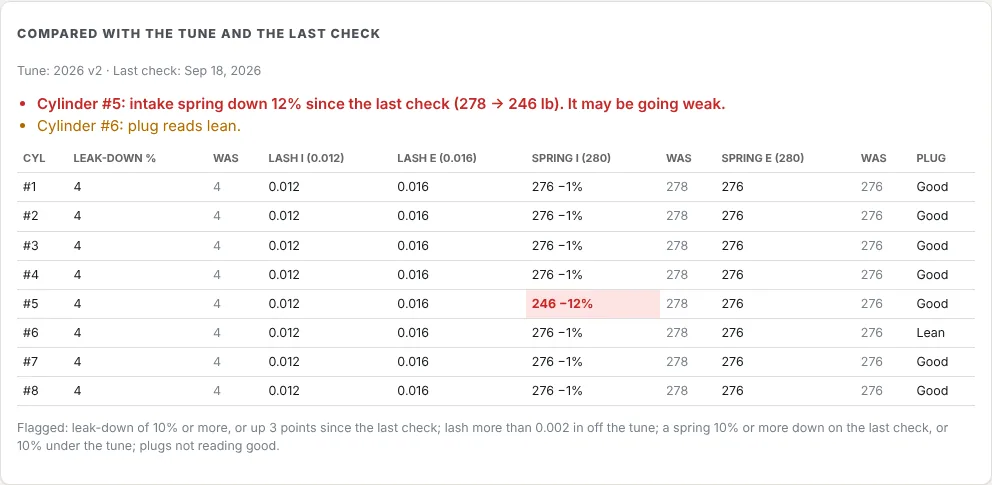

A workshop engine check records the engine service between races. It is compared with the engine's [tune](/help/engine-tunes) and with the engine's last check, so a weak spring, a cylinder losing compression or a lean cylinder stands out.

## What's on it

| Section | What you record |
|---|---|
| **Engine check** | The engine, date, car, who checked it, the tune to compare with (the engine's active tune is picked for you) and whether the leak-down was done warm or cold |
| **Engine health** | For each cylinder: leak-down %, intake and exhaust valve lash, intake and exhaust spring seat pressure, and what the plug shows (good, lean, rich, oily or detonation). The plug gap you set them to |
| **Fuel system & injectors** | Flush the methanol system; nozzles cleaned and seals checked; fuel filters opened and flushed or replaced; the main bypass and high-speed pills fitted; high-speed and secondary valves seating; throttle linkage and both return springs; fuel lines for rub, heat damage and kinks |
| **Oil, lubrication & filtration** | Oil level; whether the oil was changed; oil filter cut open, and what it showed (clean, minor specks, or metal found); dry-sump tank vent; air filter and pre-filter; injector hat seals |
| **Cooling & exhaust** | Radiator damage and leaks, pressure test, water level, header cracks, blown exhaust gaskets |
| **Cam drive (power steering & wing)** | The cam spud and 3/8" drive hex for rounding; the -10 and -6 wing adjuster lines for leaks |
| **Ignition, electrical & mounting** | Mag or ignition box covered, dry and tight; wiring harness; motor plate bolts torqued; header flange bolts; U-joint and torque ball |
| **Sign-off** | Who signed the engine off, parts needed for the next race, and notes |

The cylinders are laid out by bank: 1, 3, 5 and 7 on the top row, 2, 4, 6 and 8 below.

## Do a check

1. Go to **In the Workshop → Engine checks**.
2. Under the engine, press **New engine check**.
3. Work down the sheet. Type each cylinder's readings and tick each job as you do it.
4. Fill in **Parts needed for the next race**, then **Signed off by** when the engine is ready.
5. Press **Save**.

Prefer paper on the bench? Press **Print blank** under the engine for a sheet to fill in by hand. It shows the tune's lash, spring pressure, plug gap and pill to check against. Open a saved check and press **Print** to print it filled in.

## Compared with the tune and the last check

Under the check, **Compared with the tune and the last check** shows each cylinder's readings beside the tune and the last check, and lists anything to look at:

- leak-down of 10% or more, or up 3 points or more since the last check (fading rings or valve seals);
- valve lash more than 0.002 in off the tune;
- a spring 10% or more down on the last check (going weak), or 10% or more under the tune's seat pressure;
- a plug that doesn't read good;
- the plug gap or main bypass pill not matching the tune;
- metal found in the oil filter.

The list updates as you type. On **Engine checks**, each check shows **all good** or how many things there are to look at.

**Who can do this:** roles with **Workshop engine checks** rights. Mechanics and engine builders can do checks; roles that can delete car maintenance or engine builds can also delete them.
