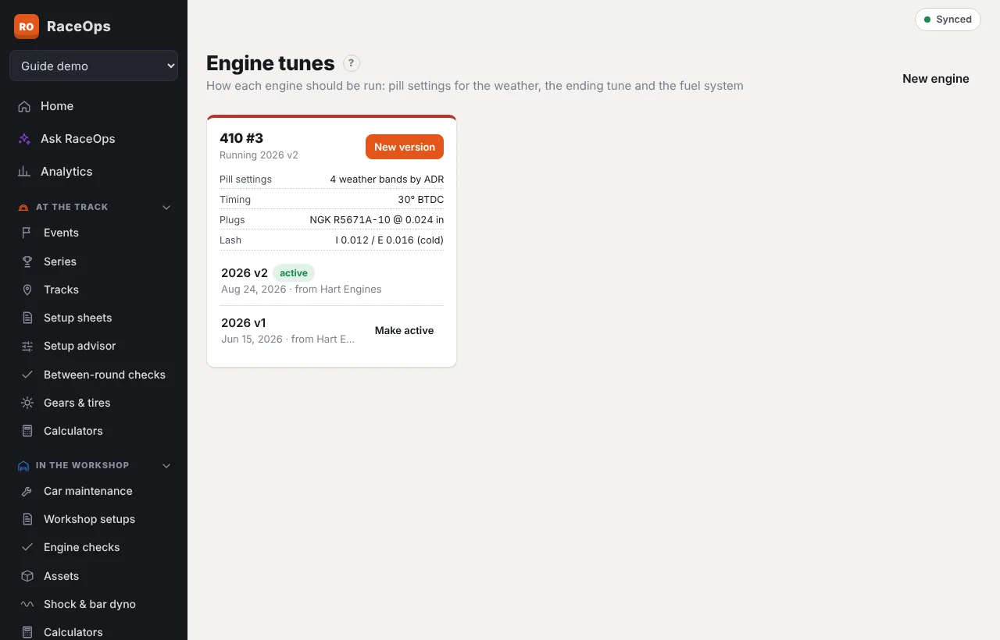
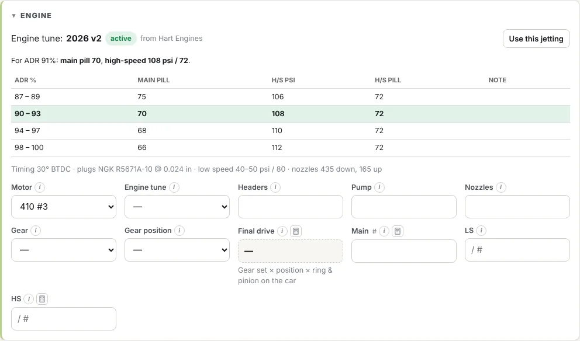

An engine tune sheet says how an engine should be run: the pill settings for the weather, the ending tune (plugs, valve lash, springs, timing, ram tubes and oil) and the fuel system. It can come from your engine builder or be one your team worked out.

Each engine can have several **versions** of its tune. One is marked **active**, normally the newest. Setup sheets and workshop setups use the active version.

## What's on it

| Section | What you record |
|---|---|
| **Tune** | The engine, a version name (e.g. *2026 v2*), the date, whether it's the active version, whether it came from the engine builder or your team, the build it goes with, the injection or induction, and who prepared it |
| **Fuel settings by weather** | The **pill settings** chart, by ADR % or by density altitude. One row per weather band: From, To, **Main pill**, **H/S pressure (psi)** and **H/S pill** |
| **Ending tune** | Spark plugs and gap; intake and exhaust valve lash, and whether it's set cold or hot; intake and exhaust valve spring tension (seat pressure); the springs used; ignition timing; ram tube length; oil level and the recommended oil |
| **Fuel system** | Fuel pump, metering block %, low-speed pressure and pill, high-speed type, and the down and up nozzles |
| **Adjustment reference** | How to set the lash on this engine, and the rocker stud and rocker stand bolt sizes and torques |
| **Notes / changes / run results** | Anything else to run, check or avoid, and the session or run the version was tested at |

A range is fine where your builder gives one, e.g. a metering block of *20–22* or a low-speed pressure of *40–50*.

## Add an engine's tune, or a new version

1. Go to **Engine Builds → Engine tunes** (or **At the Track → Engine tunes** if your role doesn't see Engine Builds).
2. Under the engine, press **New tune**, or **New version** if it already has one. A new version starts from the newest one, so you only change what's different.
3. Give it a **Version** name and fill it in. Type the pill settings in one row per weather band.
4. Leave **Active version** ticked to make it the one the team runs, then press **Save**. The engine's other versions are unticked.

To go back to an older version, press **Make active** beside it, either on the Engine tunes page or under the tune.

## Print it

Open the tune and press **Print**. It's laid out like an engine builder's tune sheet, ready to print or save as a PDF for the trailer.

## At the track: the pill settings for tonight's weather

On a setup sheet, the **Engine** section shows the motor's tune once you pick the motor:

1. Fill in the **ADR** (or **ALT** for a chart by density altitude) in **Weather**, or press **Get track weather**.
2. The row for that weather is marked in the chart, and the panel says what to run, e.g. *For ADR 91%: main pill 70, high-speed 108 psi / 72*. A reading between two rows takes the nearest one. A reading off either end of the chart says so: check with your engine builder.
3. Press **Use this jetting** to put the main, high-speed and low-speed settings and the nozzles on the sheet. The sheet's **Engine tune** records the version you ran.

Picking the motor picks its active tune. You can choose another version under **Engine tune**; the panel shows *not the active version* when you do.

## In the workshop

A [workshop setup](/help/workshop-setups) shows the motor's tune in **Drivetrain & engine**. **Fill timing & fuel system from the tune** copies the timing, nozzles and bypasses across. [Engine checks](/help/engine-checks) compare their readings with the tune.

## Tunes from your engine builder

If your engine builder uses RaceOps:

- **Engine shops:** tunes you write for a customer's engine are shared with the owner, on their [engine page](/help/share-engine-page) and in their linked team. Untick **Share with the engine’s owner** to keep a version to yourself.
- **Race teams:** on a linked engine (**Engine Builds → Engines from your engine builder**), **Engine tunes from …** lists the tunes your builder shared. Press **Use this tune** to copy one into your engine tunes as the active version, so it's on hand at the track with no connection. When the builder changes it, **Update ours** brings the change across. See [Engines from your engine builder](/help/linked-engines).

**Who can do this:** roles with **Engine tunes** rights. Roles that edit engine builds or setup sheets can add and change tunes; drivers can read them, so the pill settings are there at the track.
