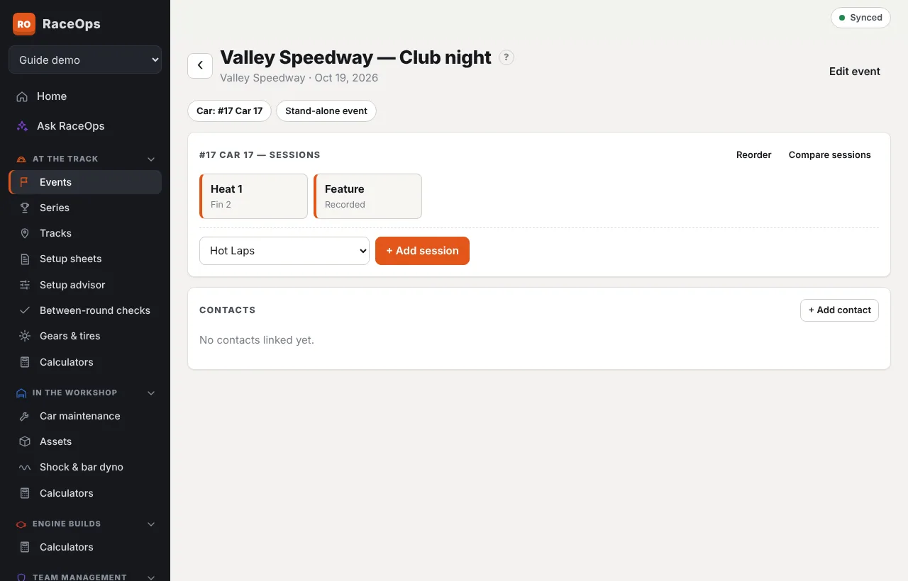
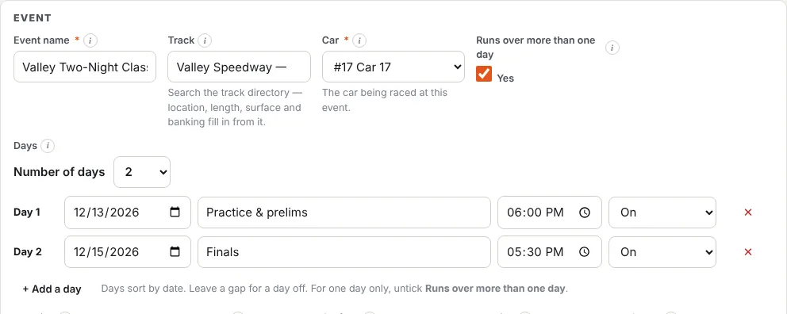

An **event** is one race meeting for one car. Each **session** (Hot Laps, Heat 1, Feature…) gets its own setup sheet. Events are also the entries on your [Calendar](/help/calendar), where you can add them straight from the series and track calendars.

## Create an event

1. Go to **At the Track → Events** and press **New event**. You can also use **New event here** on a track.
2. Pick the **Track** from the directory; your own tracks are listed first. Location, length, surface and banking fill in from it, and you can still change them.
3. Pick the **Car**. If the team has only one active car, it's chosen for you.
4. Set the **Date**. For a meeting over more than one day, tick **Runs over more than one day** instead and set each day (see below).
5. If it's a round of a championship, pick the **Series** and type the **Round**.
6. If the car was set up in the shop for this meeting, pick its **Workshop setup**. The track sheets can then start from it (see [Workshop setup sheets](/help/workshop-setups)).
7. Press **Save** at the top of the form. **Save** and **Cancel** stay in view as you scroll.

**Events** lists upcoming and past meetings. Each shows its round and track first, e.g. *Rd 3 · Valley Speedway*, then the series and the car. Lists elsewhere, such as **At the Track**, **Calendar**, each series and each track, show events the same way.

## Add sessions

On the event, press **+ Add session**. The next unused standard session is suggested (Hot Laps, Qualifying, Heat 1, Heat 2, Dash, B-Main, Feature, Practice). Choose **Other** to type any name, e.g. *Last chance*. Each session opens a new [setup sheet](/help/setup-sheets).

Sessions are listed in their usual running order. **Reorder** moves them with ▲ ▼ to match how the night actually ran.

- **Compare sessions** puts the event's sheets side by side. See [Compare and search setups](/help/compare-search).

## Multi-day events

A meeting over more than one day is still **one event**: one entry on the calendar, one set of details, and one place for all its setup sheets. Each day has its own row, so the days don't have to run one after another. A practice night on Thursday and race day on Saturday leaves Friday free.

1. On the event, press **Edit event**.
2. Tick **Runs over more than one day**. Two days appear, starting on the event's date.
3. Set the **Number of days**, or press **+ Add a day**. Each new day starts the day after the last one.
4. For each day, set its **date**. You can also give it a **name** (e.g. *Practice*, *Night 1*, *Finals*) and a **start time**.
5. If a day doesn't run, set it to **Rained out** or **Cancelled**. It stays on the event, crossed out.
6. Press **Save**.

The event's date and end date are set from the days. Days are listed by date, whatever order you add them in.

**On the event,** each day gets its own tab, named after the day (or *Day 1*, *Day 2*…) with its date. While the meeting is on, it opens on today's day. A sheet you add goes on the tab you're on. On a setup sheet, **Day** lists the event's days, so you can move a sheet to another day.

**Elsewhere,** the calendar's month view marks each day the event runs, not the days in between. Lists show the days, e.g. *Thu 4 & Sat 6 Dec 2026*. Your published calendar and its **Subscribe** link have one entry per day. The weather on a setup sheet starts at that day's date and start time.

**Taking a day off:** a day that has setup sheets can't be removed, and you can't untick **Runs over more than one day** while a later day has sheets. Open each sheet, change its **Day**, then remove the day.

**Quick edit on the calendar:** for an event whose days run one after another, changing the **Date** moves all the days, and the **End date** adds or takes off days at the end. Days with gaps between them are changed in **All details**.

Events from older versions of RaceOps with a date and an end date open with one row for each day in between.

**Who can do this:** anyone whose role can edit events.

## Series

**At the Track → Series** holds your championships: name, season, class, sanctioning body and points notes. A series lists its rounds with each car's feature finish.

- **Shared series:** a series from the shared calendars is kept by the RaceOps admin. Press **Request a change** if something's wrong. Keep your own notes under **Our notes**.
- **Your own series:** a series your team set up shows **Our own series**. **Send to shared calendars** shares it, with its rounds, for every team. Once it's approved, your rounds point at the shared series. See [Calendar](/help/calendar).

The **At the Track** hub shows your next event and recent between-round checks.
