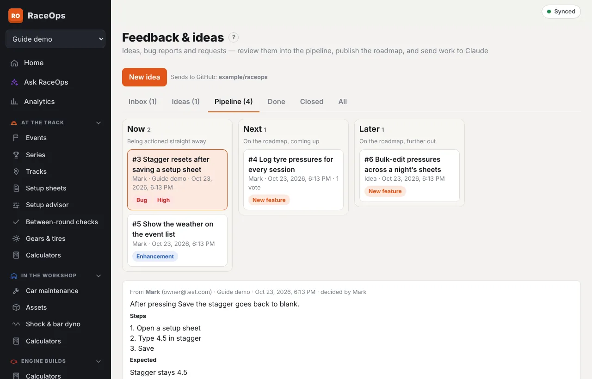

Everything people send from **Feedback & roadmap**, and your own ideas, come together in **Platform admin → Feedback & ideas**. You review each item into one pipeline, decide what goes on the public roadmap, and send work to Claude to action.

The sidebar and the **Inbox** tab show how many items are waiting for review. If email is set up, you also get an email for each new item and each answer.

## The tabs

| Tab | What's in it |
|---|---|
| **Inbox** | Problem reports and requests waiting for review |
| **Ideas** | Your own ideas, still drafts |
| **Pipeline** | Approved items in three columns: **Now**, **Next** and **Later**. Items being worked on show **In progress**. |
| **Done** | Finished items, with their release |
| **Closed** | Declined, duplicate and withdrawn items |
| **All** | Everything |

Tap an item to open it under its row. It shows who sent it, their team, the details, attached files, the conversation, and for problem reports the page, device, browser and sync status.

## Capture an idea

1. Press **New idea**.
2. Fill in the **Title**, **Kind** (bug, enhancement, new feature or change), **Priority**, and **What and why**.
3. Add **Done when**: the acceptance criteria that say when it's finished.
4. Press **Link to areas…** and tick the functionality it touches, such as **Setup sheets & advisor** or **Offline and sync**. The areas tell Claude which parts of the code and guide to look at.
5. Tick **Show on the public roadmap** if everyone should see it once approved, and write a one-line **Roadmap summary**.
6. Press **Save idea**. It waits under **Ideas** until you review it.
7. Press **Add file** on the idea to attach anything that helps: a sketch, a screenshot, an example spreadsheet or a supplier's PDF.

## Files on items

Every item, from a user or your own idea, takes up to 5 files of up to 20 MB each: pictures, screen recordings, PDFs, Office files, text, CSV, JSON, log and ZIP files. Press **Add file** on the open item to add one, and **×** beside a file to remove it. Pictures show as thumbnails; other files show their name and size, with **Download**. The sender can remove only the files they added.

**Send to Claude** lists the attachments in the brief under **Attachments**. A GitHub issue can't carry them, so the brief says they're in RaceOps on that item.

**Edit** changes any of these later, on ideas and on items people sent. Use it to tidy a title, set the priority or link the areas before you approve.

## Review an item

Open the item, type a note if needed, then:

- **Approve → Now**, **→ Next** or **→ Later** adds it to the pipeline. **Now** means action it straight away; **Next** and **Later** put it on the roadmap. Enhancements, features and changes go on the public roadmap unless you untick **Show on the public roadmap**; problem reports don't.
- **Decline** turns it down. A note is needed, and the person who sent it sees it.
- **Mark as duplicate** links it to the original (choose it from the list). The sender's vote moves to the original.
- **Ask the submitter** sends your note as a question. They answer from **My submissions**, and the conversation shows on the item.

The person who sent it is told of every decision, in the app and by email.

## Run the pipeline

On an approved item:

- **Lane** moves it between **Now**, **Next** and **Later**.
- **Start** marks it **In progress**.
- **Mark done** finishes it. Type the **Release** it ships in, such as *1.6.0*, first.
- **Reopen** brings a done, declined or duplicate item back for review.

The roadmap that everyone sees shows approved public items with their **Roadmap summary** and votes. Use the votes to choose what moves from **Later** to **Next** to **Now**.

## Send to Claude

When an approved item is ready to be worked on, press **Send to Claude…**.

1. RaceOps writes a **brief** with everything needed to do the work:
   - the description, steps and acceptance criteria;
   - the conversation;
   - the functionality areas and their code files;
   - the user guide articles to update;
   - the rules in the repository's `CLAUDE.md` (guide, design document and end-to-end tests).

   Edit it if you like.
2. Then either:
   - **Create GitHub issue** — creates an issue in the RaceOps repository that asks Claude to action it and open a pull request. This needs the Claude GitHub app installed on the repository, and GitHub set up on this server (see below). The item moves to **In progress**, with a link to the issue. **Check GitHub** shows whether the issue is still open. If you change the brief later, **Post updated brief to the issue** adds it as a comment.
   - **Copy brief** or **Download .md** — paste it into a Claude Code session in the RaceOps repository yourself. Press **Mark as sent** so the item shows **In progress**.

When the work is merged and released, open the item and **Mark done** with the release.

## Set up GitHub

In the Portainer stack, set:

| Variable | Value |
|---|---|
| `GITHUB_TOKEN` | A fine-grained GitHub token for the repository with **Issues: Read and write** |
| `GITHUB_REPO` | The repository, e.g. `mdburlace/raceops` |
| `GITHUB_ISSUE_LABELS` | Labels for new issues (default `raceops-feedback`; comma-separated) |
| `CLAUDE_MENTION` | How the issue calls Claude (default `@claude`) |

To have Claude act on the issues, install the Claude GitHub app and its GitHub Action on the repository. In Claude Code, run `/install-github-app`. Until GitHub is set up, **Send to Claude** offers only **Copy brief** and **Download .md**.

## Who can do what

Only platform admins can see this page. Everyone signed in can send feedback and vote (see [Feedback and the roadmap](/help/feedback)).
