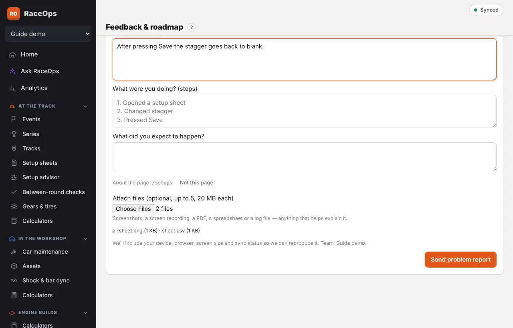
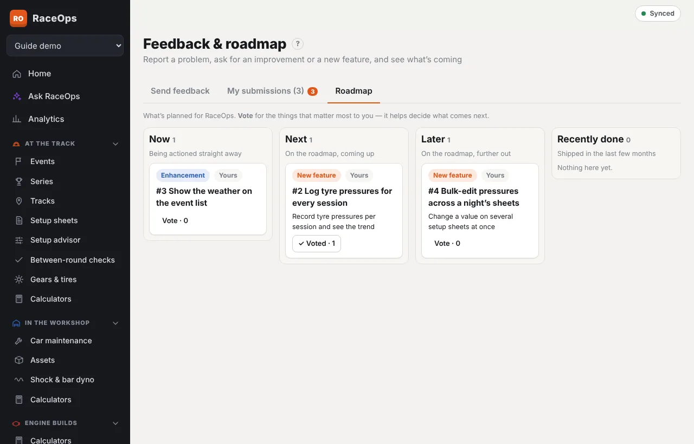

Found something that isn't working, or have an idea that would make RaceOps better at the track or in the workshop? Send it from **Feedback & roadmap** in the sidebar. Anyone signed in can send feedback. It goes to the RaceOps platform admin, who reviews it.

Feedback needs an internet connection. If you're at the track with no signal, note it down and send it later.

## Report a problem

1. Open **Feedback & roadmap**. If you open it from the sidebar while you're on the screen with the problem, that screen is noted for you.
2. Choose **Something isn't working**.
3. Give it a short title, such as *Setup sheet won't save stagger*.
4. Fill in:
   - **What went wrong?** — what you saw, including any message on screen.
   - **What were you doing?** — the steps, one per line.
   - **What did you expect to happen?**
5. Add up to three **Pictures**, such as a screenshot of the problem.
6. Press **Send problem report**.

Problem reports include your device, browser, screen size and sync status, so the problem can be reproduced. They never include your team's setups or other records.

## Ask for an improvement or a new feature

1. Choose **Improve something** (for a screen or feature that already exists) or **A new feature**.
2. Give it a short title. As you type, **Already on the roadmap?** shows matching items. If one is what you mean, press **Vote** on it instead of sending another.
3. Under **What would you like, and why?**, say what you'd use it for and how it would help.
4. Press **Send request**.

## My submissions

**My submissions** lists everything you've sent, newest first, with its status:

| Status | Meaning |
|---|---|
| **Waiting for review** | Not looked at yet. **Withdraw** takes it back. |
| **Approved**, with **Now**, **Next** or **Later** | Accepted. **Now** is being actioned straight away. **Next** and **Later** are on the roadmap. |
| **In progress** | Work has started. |
| **Done** | Finished, with the release it's in. Open the app to get the latest version. |
| **Not going ahead** | Declined. The note says why. |
| **Already requested** | Someone asked for the same thing. Your vote has been added to theirs. |
| **Withdrawn** | You took it back. |

If the admin has a question, it shows under your item. Type your answer and press **Send answer**.

When anything changes, **Feedback & roadmap** in the sidebar shows a number, and the item is marked **Updated**, until you open **My submissions**. If your server has email set up, you get an email too. You can turn emails off under **Profile & device**.

## The roadmap

**Roadmap** shows what's planned, in four columns:

- **Now** — being actioned straight away;
- **Next** — coming up;
- **Later** — further out;
- **Recently done** — shipped in the last few months.

Press **Vote** on the things that matter most to you, and press it again to take your vote back. The number of votes helps decide what comes next. Problem reports, and anything not yet approved, don't appear on the roadmap.

## Who can do what

| Job | Who |
|---|---|
| Send feedback, see your own submissions, vote | Everyone signed in |
| Review, approve, decline, and run the roadmap | Platform admins — see [Feedback and ideas (platform admin)](/help/feedback-admin) |
