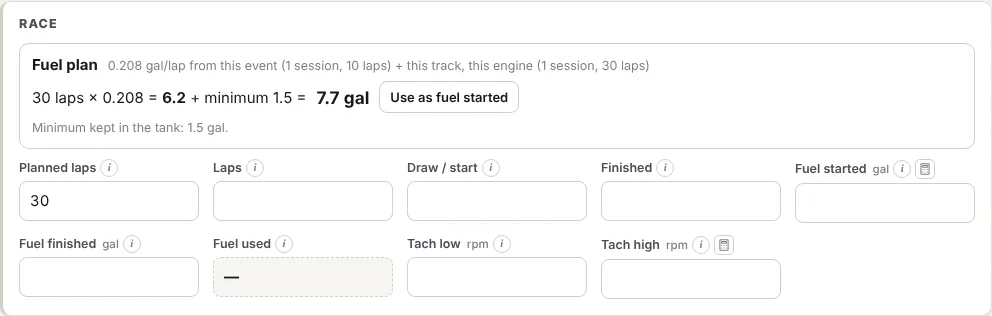

The **Race** section of every setup sheet starts with a **Fuel plan**.

## How it works

**Fuel to start with = planned laps × fuel per lap + minimum fuel.**

- **Planned laps.** Enter the laps you expect to run: race laps plus any pace or caution laps.
- **Fuel per lap.** Worked out from sessions where laps, fuel started and fuel finished were all filled in. In order:
  1. This event's earlier sessions, plus this track with **this engine** at other events.
  2. If there are none: this track with this car.
  3. If there are none: this car at any track.

  The plan shows which sessions it used, and how many laps.
- **Minimum fuel.** The car's **Minimum fuel (pickup)**, so you never run low enough to uncover the pickup. Set it on the car; see [Add your cars](/help/cars).

Press **Use as fuel started** to put the prediction into *Fuel started*.

## Warnings

- **Fuel started is below the prediction.** The tank could drop below the minimum before the end.
- **Fuel finished was below the minimum.** The pickup may have uncovered. Check the fuel per lap, or add margin.

## Keep it accurate

The plan is only as good as what's recorded. After each session, fill in **Laps**, **Fuel started** and **Fuel finished**. *Fuel used* is calculated. Sessions with any of the three missing are left out.

The **Fuel for a race** calculator (button beside *Fuel started*) does the same sum by hand.

## US gallons or litres

Fuel can be recorded in **US gallons** or **litres**. The controls are at the top of the fuel plan:

- **Fuel recorded in** is the unit this sheet's fuel started and finished are in. New sheets use the team default. Changing it converts the amounts already entered, e.g. 20 L becomes 5.28 gal.
- **Show in** switches what's on screen between US gal and litres, without changing what was recorded. While it shows the other unit, the fuel boxes are read-only; switch back to edit.
- **Make … the team default** (owners and anyone with **Edit team settings**) sets the unit new sheets and cars start in.

The fuel plan works across units: sessions recorded in litres and gallons are combined correctly, and the car's minimum fuel can be in either.
