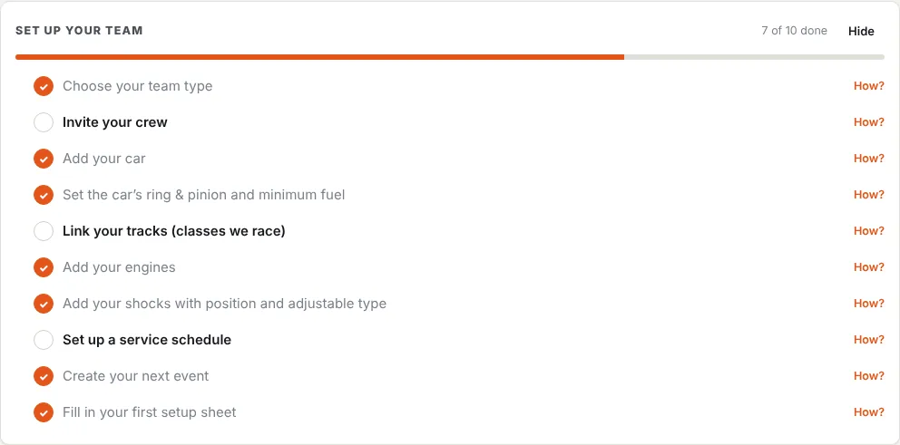

Work through these in order. Each step takes a few minutes, and the **Set up your team** checklist on Home ticks them off as you go. Owners and anyone with a team admin right see the checklist.

## 1. Choose your team type

Race team, engine shop, or both. This decides what shows in the menu. See [Choose your team type](/help/team-type).

## 2. Invite your crew and set their roles

Invite people from **Team → Members & invites**. Each invite has a role. The built-in roles (Owner, Crew Chief, Mechanic, Driver / Viewer) suit most teams. See [Invite your crew](/help/members-invites) and [Roles and permissions](/help/roles-permissions).

## 3. Add your cars

For each car, set its **gear list**, **ring & pinion ratio** and **minimum fuel (pickup)**. Final drive, the gear calculator and the fuel planner use them. See [Add your cars](/help/cars).

## 4. Link your tracks

Set **Classes we race** on the Tracks page, and tracks that run those classes appear under *Our tracks*. You can also link any track by hand. See [Tracks and classes](/help/tracks).

## 5. Add your assets

Add engines, shocks, torsion bars and anything else with a service life. For shocks, set the **position** (LF, RF, LR, RR) and **adjustable type** so setup sheets show the right shocks and adjuster boxes. See [Assets](/help/assets).

## 6. Set up service schedules

For example, "Rebuild LF shock every 8 races" or "Freshen engine every 600 laps". Laps and races are counted from setup sheets. See [Checklists and service schedules](/help/maintenance).

## 7. Create your next event and fill in a setup sheet

See [Events and sessions](/help/events-sessions) and [Fill in a setup sheet](/help/setup-sheets).

## Engine shops

Engine shops do steps 1 and 2, then:

1. [Set shop rates, tax and terms](/help/shop-settings).
2. [Add customers and their engines](/help/customers).
3. [Open jobs](/help/shop-jobs) with parts and labour.

## The checklist on Home

The checklist shows until every step is done. **Hide** removes it for you, for this team. To bring it back, open this page and choose **Show the setup checklist on Home again**.

{{checklist}}
