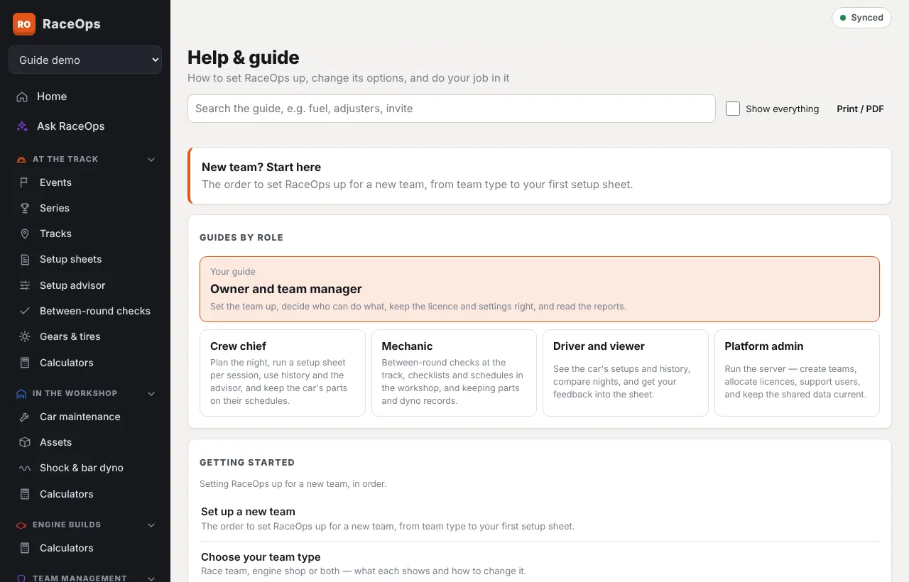

- **Help** in the sidebar (under Profile & device) opens this guide. It's stored on your device, so it works offline at the track.
- **?** at the top of most pages opens the article for that page.
- **ⓘ** beside a field explains what to enter and where to get the number.

The guide opens on **Guides by role**, with **Your guide** first: how to do your job in RaceOps, step by step. It shows the articles that fit your role and team. **Show everything** lists every article, e.g. to see what another role can do.

## Print it or save it as a PDF

**Print / PDF** at the top of Help puts the whole guide on one page with a contents list, ready to print or save as a PDF. It includes your role's guide first, then everything else that fits your role. Tick **Every role** for the complete guide, e.g. a manual for a new crew member's first night.

## Settings in one place

[All settings and options](/help/all-settings) lists every switch in one table: where it is, who can change it and what it does.

The guide is updated with every RaceOps release, and some tables (roles, settings, calculators) are built from the app itself, so they're always current.
