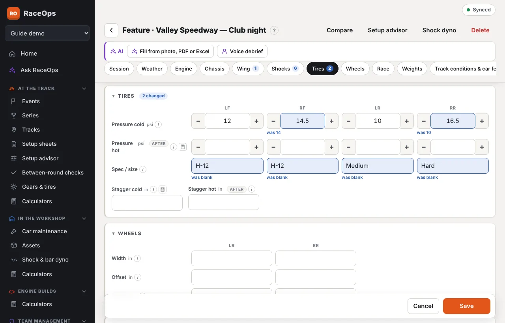
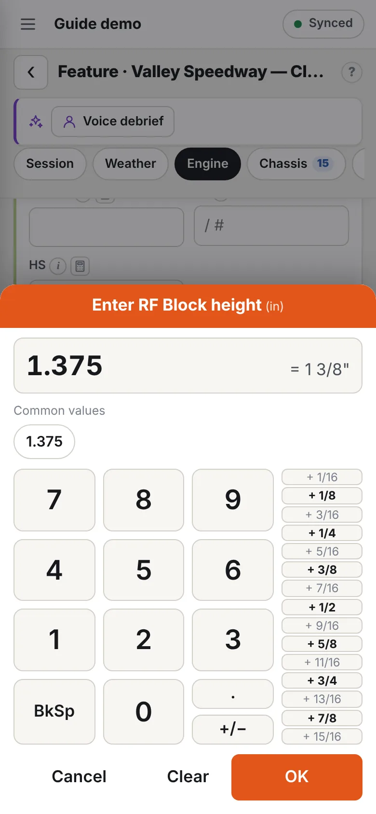
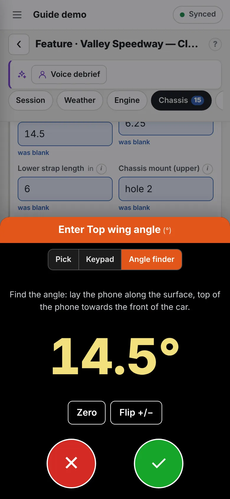

The setup sheet is laid out for quick changes at the track.

## Jump to a section

The row of section buttons under the title stays in view as you scroll.

- Tap a section to jump straight to it. The button for the section you're in is dark.
- A number on a button (e.g. **Tires 1**) is how many values in that section differ from the session you copied from.
- On a phone, swipe the row sideways to see the rest.

## Put sections in your order

**⇅ Arrange** at the end of the row lists every section.

- Use **↑** and **↓** to put the sections you use most at the top.
- Untick **Show** to hide a section you don't use. Its data is kept, and **+1 hidden** on the row opens Arrange again. Session can't be hidden, because it holds required fields.
- **Reset to the team's order** puts it back.

This is just for you. It applies to every setup sheet, on every device you sign in on. The team's own order is set by an admin in [Forms](/help/forms).

## Fold sections away

Tap a section's title to fold it to one line, and tap again to open it. Folded sections stay folded next time.

**Session** folds on a saved sheet, because the title already shows the event, car and session. Its line shows the session and car. A new sheet always opens it.

## See what you changed

When a sheet is copied from another session, every value you change is highlighted in blue with **was …** under it, e.g. *was 12*. For shocks, only the adjusters you moved are highlighted.

- The bar above the sheet shows the total, e.g. **4 changes from Heat 1**.
- Tick **Changes only** to see just the changed values, e.g. to read them out to the crew before the car goes out.

Changes are counted against the session the sheet was copied from. A sheet that wasn't copied is compared with the previous session at the event. Readings taken after the session (see below) aren't counted.

## Before and after the session

Fields recorded after the session are marked **after**:

- hot pressures and hot stagger;
- shock travel;
- laps, finish, fuel finished and fuel used;
- tach readings;
- conditions and feedback.

The **All · Before · After** switch shows just the fields for that stage. Use **After** when the car comes in, to record readings without scrolling past the setup.

## Quick entry

- **Four-corner values** sit on one row: LF, RF, LR, RR. On a phone, rows with wider boxes wrap to two per line.
- **− and +** buttons beside the values you change most: cold and hot pressures (0.5 psi), wing and nose wing angle (0.5°), turns (half a turn), main jet (1), and shock adjusters (1 click).
- **Enter** moves to the next box: LF → RF → LR → RR, then the next row.
- Number boxes open the number pad on a phone.
- **Long-press** a number box for the quick add screen (below).

## Quick add screen

Long-press any number box on a setup sheet (track or workshop) to open the quick add screen. On a computer, right-click the box. It works on any number: block height, turns, ride height, pressures, stagger, rpm, weights and the rest.

- **Big keypad.** Type the number, then press **OK**. **BkSp** takes off the last digit, **.** adds a decimal point and **+/−** makes it negative. On a computer you can type on the keyboard too: **Enter** is OK and **Esc** is Cancel.
- **Fractions.** Boxes measured in inches and fractions (block height, turns, ride height, stagger, wheel offset and spacing, wing slider and the Jacobs ladder) have **+ 1/16** to **+ 15/16** down the side. Type the whole number, then press the fraction: *1* then **+ 3/8** gives 1.375, shown as *1 3/8"*. Pressing another fraction changes it rather than adding to it. The eighths are in bold.
- **Last session.** The same box on the session before — the sheet this one was copied from, or this car's previous sheet — e.g. *Last session (Feature): 4*. Tap it to use it.
- **Say it.** Press **🎤 Say it** and say the number: *one and three eighths*, *fourteen point five*, *minus two* or *eight thousand seven fifty*. It shows what it heard; press **OK** to use it. It works in Chrome, Edge and Safari (not Firefox) and asks to use the microphone the first time. Say the number on its own; if it doesn't catch a number, it says so and leaves the box as it was.
- **Common values.** The values your team uses most in that box (for this car first) are listed. Tap one to use it.
- **Cancel** leaves the box as it was. **Clear** empties it.

Only people who can change the sheet get the quick add screen.

## Angles: Pick and the angle finder

Angle boxes (top and front wing angle, chassis rake and tilt, birdcage angles, and caster and camber on a workshop setup) open on **Pick**: a list of angles in half or quarter degrees. Tap one and press **OK**. **Keypad** types one instead.

**Angle finder** uses your phone's tilt sensor:

1. Long-press the angle box and press **Angle finder**.
2. If the car isn't sitting level, lay the phone on a level reference (such as the frame rail on the setup pad) and press **Zero**.
3. Lay the phone along the wing (or frame rail, or birdcage), top of the phone towards the front of the car. The angle shows in big numbers.
4. Press the green **✓** to put it in the box, or the red **✕** to cancel.

- **Flip +/−** swaps the sign if the phone is the other way round.
- The zero stays while the app is open, so you can zero once and measure several things. **Reset zero** goes back to the phone's own level.
- On an iPhone, press **Use the tilt sensor** the first time and allow it.
- A computer, or a phone without a tilt sensor, says so. Use **Pick** or the keypad.

## Wing has its own section

Top wing angle, wicker, slider position and nose wing angle are together in **Wing**. Radius rods and rear steer are in **Chassis**, with bars, block height, turns and ride height.
