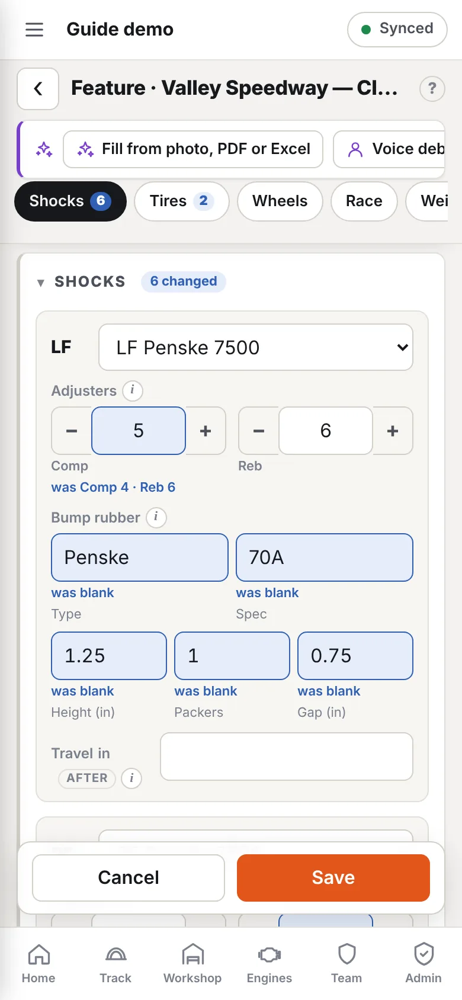

Each session at an event has one setup sheet. Fields have an **ⓘ** beside the label: tap it to see what to enter and where to get the number.

## Start a sheet

Add a session to an event (see [Events and sessions](/help/events-sessions)). The new sheet asks where to start:

- **Copy a session.** Lists this event's sessions in running order, then the car's earlier events. The default is the session just before this one.
- **Last time out.** The car's sheet from its previous event.
- **Baseline.** A setup you've saved as a starting point.
- **Workshop setup.** How the car was set up in the shop. The event's own workshop setup is chosen first. See [Workshop setup sheets](/help/workshop-setups).
- **Blank sheet.**

Setup and weather are copied as starting values. These are **not** copied, because they belong to the session that ran:

- hot pressures and hot stagger;
- shock travel;
- the race result;
- conditions and feedback;
- notes and photos.

On a saved sheet, **Copy from…** offers the same choices.

## Fill it in

Jump between sections with the row of buttons under the title, and fold or reorder sections to suit you. Changed values are highlighted, and **Before / After** shows just the fields for that stage. See [Quick editing on the setup sheet](/help/setup-sheet-layout).

Some sections work things out for you:

- **Final drive** from the gear set, gear position (low/high) and the car's ring & pinion.
- **Corner weights.** Enter all four, and total, left %, rear % and cross % fill in.
- **Weather.** Pull it for the track, or calculate from your readings. See [Track weather](/help/weather).
- **Shocks.** A card per corner with the shock, its adjusters, bump rubbers and travel. Each corner lists that corner's shocks first, and adjusters show only for an adjustable shock. See [Shocks, adjusters and bump rubbers](/help/shocks-on-setup).
- **Race.** The fuel plan predicts the fuel to start with. See [Plan fuel for a session](/help/fuel-planner).
- **Calculator buttons** beside some fields (main jet, stagger, ADR…) open the matching calculator, filled in from the sheet. **Use** puts the answer in the field.

Press **Save** when done. Everything saves on the device first and syncs when there's a connection.

## Link parts, not just names

The Motor, Shocks, Bars and Gear fields pick from your [assets](/help/assets). Picking the real part adds this session's **laps and race meetings** to its service life, and links it to the event. You can still type a name if a part isn't in your list.

## Baselines

Tick **Save as a baseline setup** on any sheet and give it a name, e.g. *Archerfield slick*. You can recall it:

- when starting a sheet;
- from **Start from baseline…** on a car at an event;
- from **Setups → Baselines**.

## Fill it from paper

With the AI add-on, **Fill from photo, PDF or Excel** reads a paper sheet or a file and shows what it found for you to check. See [Fill forms from photos, PDFs and spreadsheets](/help/import-files).
