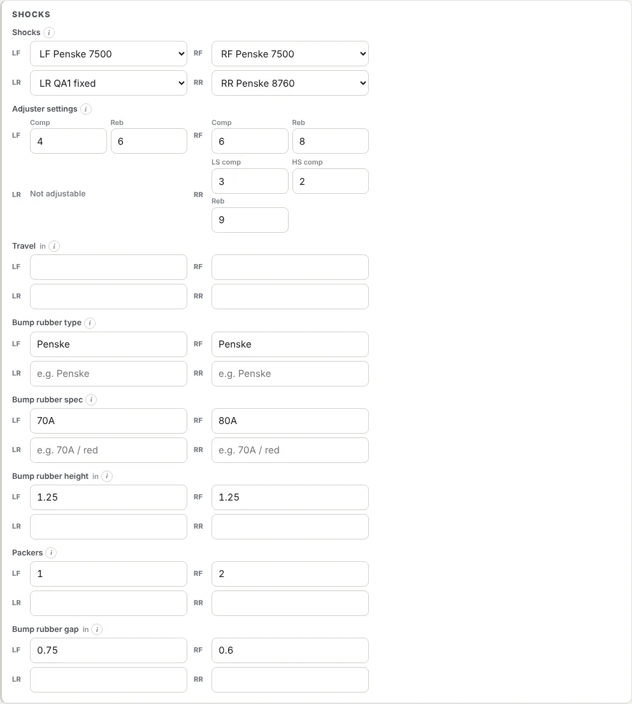
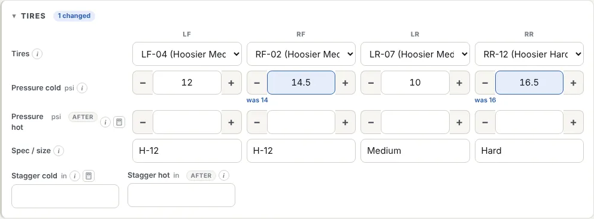
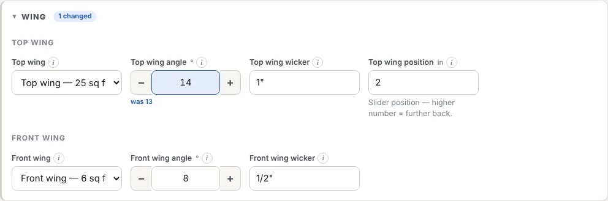

The Shocks section has a card for each corner, laid out like the car: LF and RF on top, LR and RR below (stacked on a phone). Each card holds that corner's shock, its adjusters, its bump rubber and its travel.

## Picking a shock for each corner

Each corner's list starts with the shocks that fit it:

- shocks whose **position** is that corner (an LF shock under LF), or that have no position set;
- assigned to **this car**, or not assigned to a car.

If you need a shock from elsewhere, e.g. the spare RF shock on the LF, choose **Show all shocks…** at the bottom of the list. The rest appear, each with its position shown.

Set a shock's position and car on the shock in [Assets](/help/assets). A new shock with no position appears at every corner until you give it one.

## Bars, tyres and wheels

**Bars** (in **Chassis**), **Tires** and **Wheels** each have a picker for every corner. They work like the shock picker:

- the corner's list starts under **For LF** (or RF, LR, RR) with the items whose **position** is that corner, or that have no position (tyres set to **Any** count too);
- only items for **this car**, or not assigned to a car, are listed first. **Show all…** lists the rest;
- retired bars and wheels, and worn-out tyres, aren't offered.

Bars and wheels come from [Assets](/help/assets) (categories **Torsion Bar** and **Wheel**). Tyres come from **Gears & tires → Tires** (see [Gears and tyres](/help/gears)), using their **Intended position** and **Available for cars**. Tyres show their brand, compound, size and circumference in the list.

### Not in your inventory? Enter it as it's on the car

1. Choose **Enter manually…** at the bottom of the corner's list.
2. Type what's fitted, such as *1050 lb/in Sway-Away* or *Hoosier medium 105"*.
3. That's enough for the sheet. To keep it for next time, press **+ Save to inventory**. RaceOps adds it to Assets (or Tires), set to that corner and this car, and the sheet points at it from then on.

Picking items from inventory, rather than typing them, means their laps add up and they show on the item's history.

## Wing

The **Wing** section has two parts:

- **Top wing:** the wing itself, **Top wing angle**, **Top wing wicker** and **Top wing position** (the slider).
- **Front wing:** the wing itself, **Front wing angle** and **Front wing wicker**.

Pick each wing from your wings in Assets (category **Wing**). Wings with the position **Top** are listed first for the top wing, and **Front** for the front wing. Or choose **Enter manually…** and describe it, then **+ Save to inventory** if you'll use it again.

## Adjuster settings

The adjuster boxes follow the **Shock adjustable** type set on the shock in Assets:

{{adjusters}}

- Enter clicks (or whatever unit you use) in each box. The sheet saves them as e.g. *Comp 3 · Reb 5*, which the setup advisor and Compare understand.
- A **non-adjustable** shock has no adjuster row on its card.
- **−** and **+** change an adjuster by one click. Changed adjusters are highlighted against the copied session.
- A shock typed in by hand, or with no type set, gets a single free-text box.
- **Single adjustable** shows one box, labelled *Adjuster*.

## Bump rubbers

Per corner:

- **Type:** make or style.
- **Spec:** durometer, colour code or part number.
- **Height:** free height of the stack, including packers.
- **Packers:** how many spacers are under it.
- **Gap:** distance from the rubber to the shock body at ride height, i.e. the travel before it engages.

Like the other settings, they copy into the next session's sheet.

**Travel** (from zip ties or travel indicators) is recorded after the session and isn't copied.
