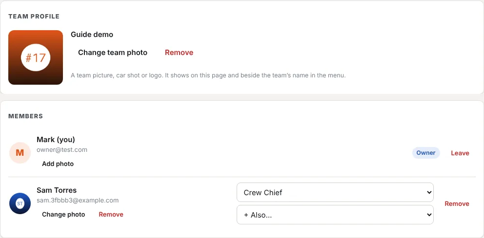

Photos make it easy to see whose team you're in and who's who.

## The team photo

A team picture, a shot of the car or the team logo. It shows under **Team profile** on the **Team** page and beside the team's name at the top of the menu.

1. Open **Team** (in the sidebar, or **Team → Members & invites**).
2. Under **Team profile**, press **Add team photo** (or **Change team photo**).
3. Choose a photo, or take one on a phone.

**Remove** takes it off; the team's initials show instead.

**Who can do this:** the owner, a role with **Edit team settings**, and a role with **Change the team photo**. The built-in **Marketing Manager** has it in new teams. To let someone else look after it, tick **Change the team photo** on their role in **Roles** (under **Administration**). See [Roles and permissions](/help/roles-permissions).

## Member photos

Each person's photo shows beside their name under **Members**, and beside your name at the bottom of the menu.

- **Your own:** open **Profile & device** and press **Add photo** (or **Change photo**) under **Your photo**.
- **Someone in your team:** on **Team**, under **Members**, press **Add photo** under their name. This needs **Invite & manage members**. Only an owner can change an owner's photo.

**Remove** takes a photo off. A photo belongs to the person, so it's the same in every team they're in, and only people who share a team with them see it.

## Good to know

- The app makes the photo smaller before sending it (at most 800 pixels across), so it's quick even on a slow connection. JPEG, PNG, WebP and iPhone (HEIC) photos all work.
- Adding a photo needs a connection.
- A team backup includes the team photo. Member photos are kept in full server backups.
